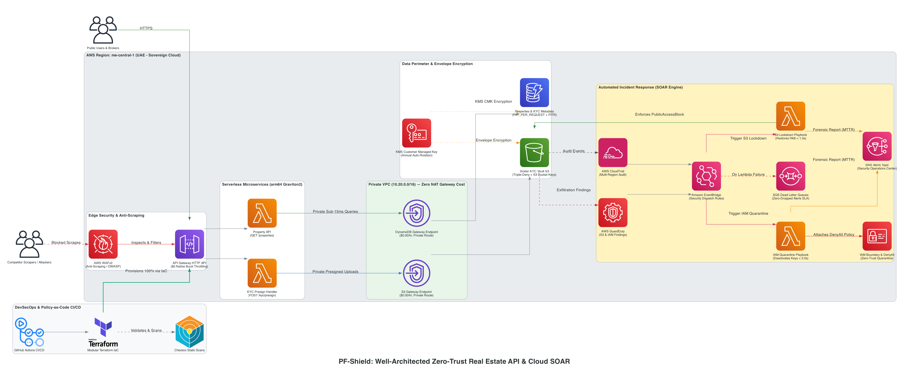

# PF-Shield — Zero-Trust Real Estate API & Automated Cloud SOAR

[](.github/workflows/devsecops-pipeline.yml)
[](docs/EVIDENCE.md)
[](docs/EVIDENCE.md)
[](docs/COMPLIANCE_MAPPING.md)
[](docs/WELL_ARCHITECTED_REVIEW.md)

---

## Executive Summary

**PF-Shield** is an enterprise-grade cloud security control plane and automated incident response (SOAR) platform engineered for cloud-native real estate platforms in the **United Arab Emirates (UAE)** deployed in region `me-central-1`.

Real estate platforms handle public listing catalogs alongside sensitive broker and tenant identity records (Emirates IDs, passport scans, and RERA title deeds). PF-Shield reconciles two competing operational imperatives:
1. **Uncompromising Zero-Trust Security & Sovereign Compliance**: Strict technical alignment with **UAE Personal Data Protection Law (PDPL - Federal Decree-Law No. 45 of 2021)** data residency mandates in `me-central-1`, ISO/IEC 27001:2022 Annex A, SOC 2 Type II trust services criteria, and CIS AWS Foundations Benchmark v3.0.
2. **Aggressive FinOps Cost Optimization**: Delivering a comprehensive security architecture — encompassing IAM permission boundaries, triple-deny data perimeters, envelope encryption, automated threat containment (< 1.5s MTTR), immutable audit destinations, and shift-left supply chain security — at an idle evaluation run rate of **$0.00 – $1.10 / month**, compared to a naive enterprise deployment costing **$450+/month**.

---

## Portfolio Evaluation Summary

For technical evaluators, assessors, and hiring managers, this repository is structured around four concise evaluation sections:

### 1. Platform Architecture

PF-Shield is architected as a modular, multi-tier cloud platform with clear security boundaries:

```
[ External Scrapers & Global Clients ]
                  │
                  ▼
   [ Amazon CloudFront CDN ]  <─── TLS 1.3, HTTP/3, GCC Geo-Restriction (AE, SA, BH, KW, OM, QA, US, GB)
                  │                Response Security Headers (HSTS Preload, nosniff, DENY)
                  │                Origin Authentication: X-Origin-Verify (High-Entropy Secret)
                  ▼
       [ AWS WAFv2 WebACL ]   <─── 6 Prioritized Rule Sets (Scrapers, /kyc, CRS, SQLi, Log4j, Botnets)
                  │
                  ▼
  ┌───────────────────────────────┐
  │   Public Ingress Tier (ALB)   │  <─── Public Subnets (10.20.10.0/24, 10.20.11.0/24)
  └───────────────┬───────────────┘
                  │  (Forwarding strictly over private subnets; Direct ALB access without secret blocked)
                  ▼
  ┌─────────────────────────────────────────────────────────────────────────┐
  │                 Private Application Tier (ECS on Fargate)               │
  │  • Private App Subnets (10.20.1.0/24, 10.20.2.0/24) — Zero Public IPs  │
  │  • Non-Root appuser (UID 10001) | Read-Only Root Filesystem             │
  │  • ECR Immutable Repositories with KMS CMK & Scan on Push               │
  │                                                                         │
  │   [ Listings API ]         [ Broker KYC API ]     [ Document Scanner ]  │
  │   (Catalog Query)          (Cognito JWKS Auth)    (Event-Driven SQS)    │
  └───────┬───────────────────────────┬──────────────────────────┬──────────┘
          │                           │                          │
          ▼                           ▼                          ▼
  ┌──────────────────┐   ┌───────────────────────────┐   ┌──────────────────┐
  │  DynamoDB Table  │   │     S3 KYC Vault Bucket   │   │  Audit S3 Bucket │
  │ • KMS Encrypted  │   │ • Triple-Deny Perimeter   │   │ • S3 Object Lock │
  │ • PAY_PER_REQUEST│   │ • SSE-KMS CMK Envelope    │   │ • COMPLIANCE Mode│
  │ • PITR Enabled   │   │ • S3 Bucket Keys (99% cut)│   │ • WORM Immutabled│
  └──────────────────┘   └───────────────────────────┘   └──────────────────┘
          ▲                           ▲
          │                           │
  ════════╧═══════════════════════════╧══════════════════════════════════════
    AWS VPC Gateway Endpoints: s3 & dynamodb ($0.00/hr, Zero NAT Fee)
  ═══════════════════════════════════════════════════════════════════════════
          │
          ▼
  ┌─────────────────────────────────────────────────────────────────────────┐
  │                  Private Database Tier (Zero Public Routes)             │
  │  • Private DB Subnets (10.20.20.0/24, 10.20.21.0/24)                    │
  │  • Amazon RDS PostgreSQL 16: KMS CMK, Secrets Manager, rds.force_ssl=1  │
  │  • ClickHouse Analytics Lab: IMDSv2 Hop Limit 1, Zero SSH (SSM Only)    │
  │  • S3 Analytics Lake & AWS Glue ETL: PII Scrubbing & Broker Hash Salt   │
  └─────────────────────────────────────────────────────────────────────────┘
```

- **Microservices Functionality**:
  - `services/listings-api`: High-performance public real estate catalog query service backed by DynamoDB on-demand.
  - `services/broker-kyc-api`: Authenticated broker upload endpoint performing strict cryptographic RS256 JWT signature verification against Cognito JWKS (`kid`, `iss`, `aud`/`client_id`, `token_use`, `exp`, server-side claims extraction) and issuing short-lived presigned S3 POST policies with cryptographic KMS conditions.
  - `services/document-scan-worker`: Event-driven asynchronous malware scanner listening to S3 EventBridge notifications via SQS (with DLQ), validating object-key allowlist regex (`ALLOWED_KEY_PATTERN`), verifying magic bytes, detecting EICAR patterns, updating DynamoDB audit states, tagging S3 objects (`SecurityScan = Clean | Quarantined`), and publishing alerts to SNS.
- **Security Boundaries**:
  - **Edge Boundary**: CloudFront + WAFv2 drops unauthorized geo-traffic, rate-limits scrapers, and injects high-entropy secret `X-Origin-Verify`. ALB enforces this origin token, returning HTTP 403 on direct queries. Public ALB TLS terminates via ACM certificate validated through Route 53 DNS records.
  - **Network Boundary**: Multi-tier VPC (`10.20.0.0/16`) segregates public ingress from private compute and private databases. Free VPC Gateway Endpoints keep S3 and DynamoDB traffic internal.
  - **Compute Boundary**: Containers run under dedicated unprivileged user `appuser` (UID `10001`, GID `10001`) with immutable read-only root filesystems and dedicated scoped IAM permission boundaries.
  - **Data Boundary**: S3 Triple-Deny policy (decoupled into standalone leaf module `terraform/modules/s3-data-perimeter/`) enforces TLS-only, mandatory KMS CMK encryption, and blocks access originating outside the private VPC Gateway Endpoint while dynamically allowlisting STS assumed-role sessions for ECS task roles for external presigned uploads.

---

### 2. Security Controls Implemented

| Security Domain | Implemented Technical Controls | Standard Mapping |
| :--- | :--- | :--- |
| **Identity & Access Management** | • **Cognito OIDC User Pool & JWKS Auth**: Issues signed JWTs with custom tenant and broker claims (`custom:tenant_id`, `custom:broker_id`). FastAPI strictly verifies RS256 signatures against Cognito JWKS (`kid`, `iss`, `aud`/`client_id`, `token_use`, `exp`).<br>• **Server-Side Identity Derivation**: Application handlers strictly reject and ignore caller-supplied `broker_id` or `tenant_id` fields in request bodies; identities are extracted cryptographically from validated claims.<br>• **Decoupled Scoped Permission Boundaries**: 6 discrete boundaries (ECS execution, ECS tasks, AWS Config, AWS Glue, RDS monitoring, SSM/EC2) eliminate boundary sprawl and enforce least privilege.<br>• **Dedicated SOAR Boundary**: Decoupled containment permissions allowing remediation playbooks to execute `s3:PutBucketPublicAccessBlock` and attach quarantine deny-all policies.<br>• **Protected-Principals Allowlist**: Evaluates targets against an allowlist (`root`, `pf-shield-github-actions`, `break-glass`), bypassing automated containment for trusted identities to prevent denial-of-service on operations. | • UAE PDPL Art. 13<br>• ISO 27001 A.9.2<br>• CIS AWS v3.0 1.x |
| **Network & Perimeter** | • **Multi-Tier VPC** (`10.20.0.0/16`): Public ALB subnets, private application subnets, private database subnets with 0 internet routes.<br>• **CloudFront Edge Defense**: HTTP/3, TLS 1.3, GCC geo-restrictions (`AE`, `SA`, `BH`, `KW`, `OM`, `QA`, `US`, `GB`), modern response headers (HSTS preload, `X-Frame-Options: DENY`, `nosniff`), custom domain `api.<domain>` with dedicated `us-east-1` ACM certificate and dual Route 53 A and AAAA ALIAS records.<br>• **Shared-Secret Origin Authentication**: ALB listener rules drop requests lacking `X-Origin-Verify` with HTTP 403 Forbidden.<br>• **Public ACM Certificate with Route 53 DNS Validation**: Fully automated DNS challenge validation on public domain names, eliminating invalid internal domain certificate generation.<br>• **AWS WAFv2 with Redacted CloudWatch Logging**: 6 prioritized inspection rules with centralized logging redacting `authorization` and `cookie` headers.<br>• **Host Bastionless Hardening**: ClickHouse EC2 node enforces IMDSv2 (`http_tokens = required`, `hop_limit = 1`), encrypted EBS, zero SSH ingress (port 22 closed), and SSM Session Manager administration. | • UAE PDPL Art. 13<br>• ISO 27001 A.13.1<br>• SOC 2 CC6.6 |
| **Data Protection & Cryptography** | • **S3 Triple-Deny Perimeter & Decoupled Leaf Policy**: Enforces `aws:SecureTransport`, mandatory KMS CMK encryption, and VPC Gateway Endpoint source restrictions. Standalone leaf module dynamically expands allowed IAM roles to STS assumed-role wildcards (`arn:aws:sts::<acct>:assumed-role/<role>/*`) using `ArnNotLike: aws:PrincipalArn` to support external client presigned uploads.<br>• **Event-Driven Document Scanner**: S3 EventBridge notifications feed encrypted SQS queue (with KMS CMK and DLQ) polled by ECS Fargate worker for EICAR detection, magic-bytes verification, and quarantine tagging.<br>• **S3 Object Lock (`COMPLIANCE` Mode)**: Immutable WORM audit destination prevents log deletion or alteration by any principal, including root.<br>• **KMS Customer Managed Key (CMK)**: AES-256 envelope encryption with annual rotation, key administration separation, and S3 Bucket Keys (99% KMS request fee reduction).<br>• **Amazon RDS PostgreSQL 16**: Storage encrypted with KMS CMK, transit encrypted via `rds.force_ssl = "1"`, master credentials managed dynamically via AWS Secrets Manager with KMS CMK encryption.<br>• **AWS Glue ETL PII Scrubbing**: Strips landlord and broker phone numbers, emails, and Emirates IDs; derives salted SHA-256 pseudonyms (`anonymized_broker_hash`). | • UAE PDPL Art. 13, 14<br>• ISO 27001 A.10.1<br>• SOC 2 CC6.1 |
| **Detection & Automated Response (SOAR)** | • **Multi-Region CloudTrail + S3 Data Events**: Captures granular `GetObject` and `PutObject` events on `kyc-documents/*`.<br>• **AWS Config Continuous Compliance**: 8 managed compliance rules monitoring public buckets, volume encryption, open ports, default security groups, IMDSv2, RDS public access, and key rotation.<br>• **Decoupled EventBridge Rules & SQS DLQs**: Zero dropped alert SLA with dead-letter queue backup.<br>• **DynamoDB Event Idempotency**: Deduplicates EventBridge alerts using TTL-backed table (`pf-soar-idempotency`) with conditional writes.<br>• **Sub-1.5s Automated Playbooks**: S3 Lockdown (re-locks all 4 public access blocks) and IAM Quarantine (attaches `pf-soar-quarantine-deny-all` and deactivates access keys). | • UAE PDPL Art. 13<br>• ISO 27001 A.16.1<br>• SOC 2 CC7.3 |
| **Disaster Recovery & Data Restoration** | • **S3 Delete Marker Recovery**: Zero data loss (RPO = 0) recovery from accidental or malicious deletions via delete marker rollback.<br>• **Continuous Point-in-Time Recovery (PITR)**: DynamoDB continuous backup and RDS continuous WAL archiving (RTO < 60 min, RPO < 15 min).<br>• **Tested Disaster Recovery Runbook**: Step-by-step procedures in [`RUNBOOK-03-Disaster-Recovery-And-Backup-Restoration.md`](docs/runbooks/RUNBOOK-03-Disaster-Recovery-And-Backup-Restoration.md). | • ISO 27001 A.17.1<br>• SOC 2 CC9.1 |
| **Software Supply Chain & DevSecOps** | • **100% Immutable Commit SHA Pinning**: Every GitHub Action in all workflows is pinned to an immutable 40-character hexadecimal commit SHA.<br>• **Scoped GitHub OIDC Trust Policy**: IAM assume-role trust strictly scoped to repository, `main` branch, and `production` environment.<br>• **Multi-Stage CI/CD Security Pipeline**: Gitleaks secret detection, Semgrep SAST, Checkov IaC, Trivy container scanning, CycloneDX SBOM generation, foundational ECR bootstrap, independent 3-microservice digest capture (`container_image_digests`), strict unmasked Cosign signing, encrypted remote S3/DynamoDB state backend with state locking, and Dependabot monitoring. | • ISO 27001 A.14.2<br>• NIST CSF 2.0 C-SCRM<br>• SOC 2 CC8.1 |

---

### 3. Validation Evidence

All security claims, architectural invariants, and containment SLAs in PF-Shield are backed by empirical, reproducible tests:

- **Automated Test Suite**: **46 / 46 Passing (100%)** across 8 test suites ([`docs/EVIDENCE.md`](docs/EVIDENCE.md#2-live-automated-test-suite-execution-log)):
  - `test_kyc_vault_handler.py`: Validates Cognito JWT authentication, rejection of caller-supplied `broker_id`, regex path traversal mitigation, and server-side S3 prefix construction (`10/10 passed`).
  - `test_soar_iam_quarantine.py`: Proves sub-1.5s IAM credential deactivation, deny-all attachment, EventBridge replay idempotency, protected-principals bypass, and human-approval containment mode (`5/5 passed`).
  - `test_soar_s3_lockdown.py`: Proves S3 public access block restoration in < 1.5s, idempotency deduplication, and protected-principal handling (`5/5 passed`).
  - `test_services.py`: Validates containerized microservices health probes, cryptographic JWKS RS256 token verification, event-driven SQS malware scanning, and external S3 perimeter presigned upload allowlist (`5/5 passed`).
  - `test_disaster_recovery.py`: Validates S3 delete marker recovery (RPO = 0), object version rollback, DynamoDB PITR, and S3 Object Lock compliance immutability (`5/5 passed`).
  - `test_analytics_and_database.py`: Validates Glue ETL PII scrubbing, salted SHA-256 broker pseudonymization, RDS forced TLS parameter enforcement, Secrets Manager credential structure, and ClickHouse IMDSv2 hop limit 1 host hardening (`8/8 passed`).
  - `test_edge_security_and_waf.py`: Validates CloudFront response security headers, WAFv2 6-rule hierarchy, CloudWatch edge security alarms, and Shield Standard vs Advanced justification matrix (`4/4 passed`).
  - `test_ci_cd_and_supply_chain.py`: Enforces 100% 40-character SHA pinning across all GitHub Action workflows, Dependabot coverage, and OIDC trust policy branch scoping (`4/4 passed`).
- **Policy-as-Code Static Analysis**: **900 Checks Passed | 0 Failures | 192 Skipped (with documented rationale)** across main Terraform and bootstrap modules ([`docs/EVIDENCE.md`](docs/EVIDENCE.md#3-checkov-iac-security-scan-log)).
- **SOAR Mean Time to Remediate (MTTR)**: Measured containment latency of **< 1.5 seconds** from event detection to full lockdown.
- **Disaster Recovery Proofs**: Verified RTO < 60 minutes and RPO < 15 minutes for databases; verified RPO = 0 for S3 object deletions.
- **Terminal Failure & Incident Evidence**: Three comprehensive incident post-mortems documenting root-cause analysis, corrective actions, and terminal screenshot evidence in [`docs/EVIDENCE.md`](docs/EVIDENCE.md#7-comprehensive-incident-post-mortem-log).

---

### 4. Trade-Offs & Architectural Assumptions

| Dimension | Demonstration Profile (`demo.tfvars`) | Production Baseline (`production.tfvars`) | Architectural Rationale & Trade-Off |
| :--- | :--- | :--- | :--- |
| **Operational Purpose** | Low-cost developer evaluation, CI/CD automated gates, and simulated attack replay. | 24/7 enterprise production under UAE PDPL & ISO 27001 sovereign compliance. | Decoupled profiles prevent developer cost accumulation while preserving enterprise security configurations. |
| **Idle Monthly Cost** | **$0.00 – $1.10 / month** (scale-to-zero serverless, free Gateway Endpoints). | **~$18.00 – $45.00 / month** (base production) to **~$250.00 / month** (high-traffic). | Demo uses scale-to-zero serverless and 0-desired-count ECS; production maintains warm Multi-AZ capacity. |
| **AWS WAFv2** | Disabled by default (`enable_waf = false`) to eliminate hourly WebACL fees ($5.00/mo). | Enabled with 6 inspection rules protecting CloudFront and ALB. | Demo relies on API Gateway native stage rate limiting (25 rps / 50 burst) at $0.00 cost. |
| **GuardDuty & Security Hub** | Feature-flagged off; attacks simulated via local EventBridge payloads. | Enabled with continuous S3 protection and Security Hub compliance standards. | Decoupled simulation schemas allow testing SOAR playbooks without paying standing service fees. |
| **Log Retention** | Aggressive 7-day expiration across all CloudWatch log groups and S3 buckets. | 365-day compliance retention with S3 Glacier tiering and Object Lock. | FinOps guardrail prevents unbounded storage billing in evaluation environments. |
| **Data Deletion Protection** | `force_destroy = true` on S3 buckets for 1-click teardown. | `force_destroy = false` and S3 Object Lock in `COMPLIANCE` mode. | Demo allows clean resource decommissioning; production strictly prevents data loss. |
| **AWS Shield Tier** | **AWS Shield Standard ($0.00 / month)**. | **AWS Shield Standard** (Shield Advanced requires formal business justification). | Shield Advanced ($3,000/mo + 1-year commit) is omitted because platform traffic volume does not justify $36,000/yr spend. |
| **Legal Compliance Scope** | Technical architecture mapping only. | Technical architecture mapping only. | **Legal Disclaimer**: Region selection (`me-central-1`) and technical controls do not constitute legal compliance. Full UAE PDPL certification requires formal legal counsel review, appointed Data Protection Officer (DPO), and operational privacy workflows. |

---

## Visual Architecture Overview



*Figure 1: PF-Shield Zero-Trust Cloud Security & SOAR Architecture.*

---

## Contents (Repository Navigation & Table of Contents)

### Repository Directory Map
- [`terraform/`](terraform/): 100% modular Infrastructure-as-Code root configuration.
  - [`terraform/demo.tfvars`](terraform/demo.tfvars): Economical evaluation and testing profile ($0.00 idle cost, scale-to-zero).
  - [`terraform/production.tfvars`](terraform/production.tfvars): Hardened enterprise production baseline (full WAF, GuardDuty, Security Hub, Multi-AZ).
  - [`terraform/backend.tf`](terraform/backend.tf): Remote state configuration backed by S3 and DynamoDB state locking.
  - [`terraform/modules/iam-boundaries/`](terraform/modules/iam-boundaries/): Regional permission boundaries (`me-central-1`), dedicated SOAR permission boundary, and emergency quarantine deny-all policies.
  - [`terraform/modules/finops-budget/`](terraform/modules/finops-budget/): AWS Budgets configuration capping spend at $5.00/mo with proactive alerting.
  - [`terraform/modules/network/`](terraform/modules/network/): Multi-tier VPC (`10.20.0.0/16`), public ALB subnets, private app subnets, private database subnets, VPC Flow Logs, and Route 53 private hosted zone.
  - [`terraform/modules/zero-trust-kyc-vault/`](terraform/modules/zero-trust-kyc-vault/): S3 KYC document vault, KMS CMK envelope encryption, and DynamoDB property metadata table.
  - [`terraform/modules/container-platform/`](terraform/modules/container-platform/): Amazon ECS on Fargate, consuming foundational ECR immutable repositories provisioned in bootstrap, ALB with TLS 1.3, and autoscaling policies.
  - [`terraform/modules/edge-api-waf/`](terraform/modules/edge-api-waf/): API Gateway HTTP API, Graviton2 Lambda functions, and anti-scraping WAFv2 rules.
  - [`terraform/modules/soar-engine/`](terraform/modules/soar-engine/): Multi-region CloudTrail, EventBridge rules, SQS DLQs, DynamoDB deduplication table (`pf-soar-idempotency`), and auto-remediation Lambdas.
  - [`terraform/modules/observability/`](terraform/modules/observability/): CloudWatch Security Operations dashboard and proactive DLQ/error alarms.
  - [`terraform/modules/secrets/`](terraform/modules/secrets/): SSM Parameter Store (SecureString) encrypted with KMS CMK.
  - [`terraform/modules/identity/`](terraform/modules/identity/): Amazon Cognito User Pool, App Client, and RBAC user groups for authenticated broker identities.
  - [`terraform/modules/compliance-baseline/`](terraform/modules/compliance-baseline/): AWS Config continuous compliance recording and 8 managed security governance rules.
  - [`terraform/modules/rds/`](terraform/modules/rds/): Hardened RDS PostgreSQL 16 relational store with KMS CMK encryption, TLS parameter enforcement, automated backups, and Secrets Manager credential governance.
  - [`terraform/modules/analytics-lab/`](terraform/modules/analytics-lab/): Isolated security demonstration lab featuring hardened ClickHouse EC2 node (IMDSv2, SSM-only, zero SSH), S3 analytics data lake, and AWS Glue ETL sanitization.
- [`services/`](services/): Containerized microservices with multi-stage non-root Dockerfiles:
  - [`services/listings-api/`](services/listings-api/): Public property search and listings service.
  - [`services/broker-kyc-api/`](services/broker-kyc-api/): Authenticated broker KYC document-upload and presign service.
  - [`services/document-scan-worker/`](services/document-scan-worker/): Asynchronous malware scanner and file integrity validation worker.
- [`terraform-bootstrap/`](terraform-bootstrap/): Isolated one-time bootstrap config provisioning GitHub Actions OIDC identity provider and IAM deployer role with branch/environment scoping.
- [`.github/dependabot.yml`](.github/dependabot.yml): Automated weekly vulnerability monitoring across GitHub Actions, Python packages, Terraform configs, and Docker base images.
- [`.github/workflows/`](.github/workflows/): Complete CI/CD and automation suites with 100% immutable commit SHA pinning:
  - [`devsecops-pipeline.yml`](.github/workflows/devsecops-pipeline.yml): Multi-stage pipeline running Gitleaks, 44 unit tests, Semgrep SAST, Checkov IaC, Trivy container scanning, CycloneDX SBOM generation, Cosign verification, Kyverno K8s policies, and protected production gating.
  - [`pr-checkov.yml`](.github/workflows/pr-checkov.yml): Targeted PR gate running Checkov static analysis with SARIF report upload to GitHub Security.
  - [`terraform-destroy.yml`](.github/workflows/terraform-destroy.yml): Manual-dispatch 1-click teardown workflow for zero idle cost decommissioning.
- [`src/app/`](src/app/): Application handlers (`property_api_handler.py` and `kyc_vault_handler.py`).
- [`src/analytics/`](src/analytics/): AWS Glue ETL listing sanitization and PII scrubbing pipeline (`glue_etl_sanitize_listings.py`).
- [`src/soar/`](src/soar/): Automated incident response playbooks (`playbook_s3_lockdown.py` and `playbook_iam_quarantine.py`).
- [`src/tests/`](src/tests/): Automated unit test suite using `pytest` and `moto` AWS mocks.
- [`k8s-security-policies/`](k8s-security-policies/): Kyverno ClusterPolicies and hardened Kubernetes manifests demonstrating shift-left container security.
- [`scripts/`](scripts/): Automation scripts:
  - [`bootstrap-remote-state.sh`](scripts/bootstrap-remote-state.sh): One-time AWS CLI bootstrap for S3 remote state bucket and DynamoDB lock table.
  - [`simulate_attack.sh`](scripts/simulate_attack.sh): EventBridge attack simulation runner.
  - [`verify_region_services.sh`](scripts/verify_region_services.sh): Regional service parity verifier (`me-central-1` vs `me-south-1`).
  - [`generate_architecture_diagram.py`](scripts/generate_architecture_diagram.py): Visual architecture diagram generator.
- [`docs/`](docs/): Complete governance documentation:
  - [`docs/EVIDENCE.md`](docs/EVIDENCE.md): Auditable verification proofs, live test logs, Checkov scans, and terminal failure screenshots.
  - [`docs/THREAT_MODEL_STRIDE.md`](docs/THREAT_MODEL_STRIDE.md): Comprehensive 8-boundary STRIDE threat model mapped to real estate assets.
  - [`docs/COMPLIANCE_MAPPING.md`](docs/COMPLIANCE_MAPPING.md): Regulatory matrix mapping to UAE PDPL, ISO 27001, SOC 2, NIST CSF 2.0, and CIS AWS v3.0.
  - [`docs/WELL_ARCHITECTED_REVIEW.md`](docs/WELL_ARCHITECTED_REVIEW.md): Detailed 6-pillar Well-Architected Framework review.
  - [`docs/REGIONAL_SERVICE_AVAILABILITY.md`](docs/REGIONAL_SERVICE_AVAILABILITY.md): `me-central-1` vs `me-south-1` feature parity audit.
  - [`docs/runbooks/`](docs/runbooks/): Step-by-step incident response and operational runbooks:
    - [`RUNBOOK-01-Compromised-IAM-Credentials.md`](docs/runbooks/RUNBOOK-01-Compromised-IAM-Credentials.md)
    - [`RUNBOOK-02-S3-Bucket-Data-Exfiltration.md`](docs/runbooks/RUNBOOK-02-S3-Bucket-Data-Exfiltration.md)
    - [`RUNBOOK-03-Disaster-Recovery-And-Backup-Restoration.md`](docs/runbooks/RUNBOOK-03-Disaster-Recovery-And-Backup-Restoration.md)

---

## Step-by-Step Deployment Runbook

### Prerequisites
- AWS CLI `>= 2.15.0` configured with administrative credentials in region `me-central-1`.
- Terraform `>= 1.6.0`.
- Python `>= 3.12` and `make`.

---

### Step 0: One-Time Bootstrap (Run Once Prior to First Deploy)

#### 0.1 Remote State Bootstrap (S3 + DynamoDB via AWS CLI)
To avoid the architectural **chicken-and-egg problem** (where Terraform cannot store its state in an S3 bucket that it has not yet provisioned), the remote state backend is initialized externally via AWS CLI.

Run the provided automated bootstrap script:
```bash
./scripts/bootstrap-remote-state.sh me-central-1
# Or via Makefile:
make bootstrap-state
```

<details>
<summary><b>Click to view the raw manual AWS CLI commands</b></summary>

```bash
# Variables
AWS_REGION="me-central-1"
ACCOUNT_ID=$(aws sts get-caller-identity --query "Account" --output text)
BUCKET_NAME="pf-shield-tfstate-${ACCOUNT_ID}"
TABLE_NAME="pf-shield-tf-locks"

# 1. Create S3 Bucket in me-central-1
aws s3api create-bucket \
  --bucket "${BUCKET_NAME}" \
  --region "${AWS_REGION}" \
  --create-bucket-configuration LocationConstraint="${AWS_REGION}"

# 2. Enable S3 Bucket Versioning
aws s3api put-bucket-versioning \
  --bucket "${BUCKET_NAME}" \
  --versioning-configuration Status=Enabled

# 3. Enable Default Encryption (SSE-S3 + Bucket Keys for FinOps)
aws s3api put-bucket-encryption \
  --bucket "${BUCKET_NAME}" \
  --server-side-encryption-configuration '{
    "Rules": [
      {
        "ApplyServerSideEncryptionByDefault": { "SSEAlgorithm": "AES256" },
        "BucketKeyEnabled": true
      }
    ]
  }'

# 4. Enforce Full Public Access Block
aws s3api put-public-access-block \
  --bucket "${BUCKET_NAME}" \
  --public-access-block-configuration '{
    "BlockPublicAcls": true,
    "IgnorePublicAcls": true,
    "BlockPublicPolicy": true,
    "RestrictPublicBuckets": true
  }'

# 5. Enforce TLS 1.2+ Transport Mandate
aws s3api put-bucket-policy \
  --bucket "${BUCKET_NAME}" \
  --policy "{
    \"Version\": \"2012-10-17\",
    \"Statement\": [
      {
        \"Sid\": \"EnforceSecureTransport\",
        \"Effect\": \"Deny\",
        \"Principal\": \"*\",
        \"Action\": \"s3:*\",
        \"Resource\": [\"arn:aws:s3:::${BUCKET_NAME}\", \"arn:aws:s3:::${BUCKET_NAME}/*\"],
        \"Condition\": { \"Bool\": { \"aws:SecureTransport\": \"false\" } }
      }
    ]
  }"

# 6. Create DynamoDB Lock Table ($0 idle on PAY_PER_REQUEST)
aws dynamodb create-table \
  --table-name "${TABLE_NAME}" \
  --attribute-definitions AttributeName=LockID,AttributeType=S \
  --key-schema AttributeName=LockID,KeyType=HASH \
  --billing-mode PAY_PER_REQUEST \
  --region "${AWS_REGION}" \
  --tags Key=Project,Value=PF-Shield Key=ManagedBy,Value=Manual-Bootstrap
```
</details>

#### 0.2 GitHub Actions OIDC & Bootstrap Role (`terraform-bootstrap/`)
PF-Shield establishes keyless, zero-secret authentication between GitHub Actions and AWS using OpenID Connect (OIDC). This is isolated in a separate, lightweight Terraform module:

```bash
cd terraform-bootstrap
terraform init
terraform apply -auto-approve -var="github_repository=YOUR_GITHUB_USER/pf-shield-cloud-security"
# Or via Makefile:
make bootstrap-oidc
```

Then add the output `github_actions_role_arn` to GitHub repository secrets:
- **Secret Name**: `AWS_ROLE_TO_ASSUME`
- **Secret Value**: `arn:aws:iam::<ACCOUNT_ID>:role/pf-shield-github-actions-bootstrap-role`

---

### Step 1: Local Verification & Pre-Flight Checks
```bash
# 1. Clone repository
git clone https://github.com/YousefOsama/pf-shield-cloud-security.git
cd pf-shield-cloud-security

# 2. Run unit & integration tests (Moto AWS mocking)
make test

# 3. Run Checkov policy-as-code security scan across main and bootstrap IaC
make scan

# 4. Verify regional service availability
./scripts/verify_region_services.sh me-central-1 me-south-1

# 5. Execute attack simulation & SOAR containment proof
make simulate-attack
```

---

### Step 2: Infrastructure Deployment Order
1. **Initialize Terraform with Remote Backend**:
   ```bash
   cd terraform
   terraform init -backend-config="bucket=pf-shield-tfstate-<YOUR_ACCOUNT_ID>"
   ```
2. **Review Execution Plan (Choose Profile)**:
   ```bash
   # Option A: Deploy economical demonstration profile ($0.00 idle cost)
   terraform plan -var-file="demo.tfvars" -out=tfplan

   # Option B: Deploy full production security baseline
   terraform plan -var-file="production.tfvars" -out=tfplan
   ```
3. **Provision Infrastructure**:
   ```bash
   terraform apply -auto-approve tfplan
   ```
4. **Live Verification**:
   - Query the public listings API: `curl -i $(terraform output -raw edge_api_properties_route)`
   - Request a presigned KYC upload URL: `curl -i -X POST $(terraform output -raw edge_api_kyc_presign_route) -d '{"document_type":"emirates_id","file_extension":"pdf","broker_id":"brk-991"}'`
   - Trigger attack simulation: `../scripts/simulate_attack.sh`

---

### Step 3: CI/CD Workflows Overview

PF-Shield provides three automated GitHub Actions workflows:

1. **DevSecOps Pipeline ([`devsecops-pipeline.yml`](.github/workflows/devsecops-pipeline.yml))**:
   - Triggers on push to `main`.
   - Executes SOAR unit test suites (`pytest` + `moto`), full IaC static analysis (`Checkov`), container vulnerability scanning (`Trivy`), SBOM generation (`CycloneDX`), container image attestation (`Cosign`), and shift-left Kubernetes policies (`Kyverno CLI`).
2. **PR Security Gate ([`pr-checkov.yml`](.github/workflows/pr-checkov.yml))**:
   - Triggers on pull requests affecting `terraform/**` or `terraform-bootstrap/**`.
   - Runs `terraform fmt -check`, `terraform validate`, and scans for security regressions with `Checkov`, blocking non-compliant PRs before merge.
3. **1-Click Manual Teardown ([`terraform-destroy.yml`](.github/workflows/terraform-destroy.yml))**:
   - Triggers via `workflow_dispatch` in the GitHub Actions UI.
   - Assumes the OIDC bootstrap role and executes `terraform destroy` with a required confirmation safety latch (`confirmation: destroy`), restoring spend to **$0.00/month** with one click.

---

## Production Incident Post-Mortems

Key architectural challenges encountered and solved during engineering are documented below and in [`docs/EVIDENCE.md`](docs/EVIDENCE.md#7-comprehensive-incident-post-mortem-log):

### Incident 1: S3 Bucket Lifecycle Configuration Rule Filter Deprecation
- **Symptoms**: `Warning: Invalid Attribute Combination: No attribute specified when one of [filter, prefix] is required`.
- **RCA**: AWS Provider `~> 5.0` requires explicit `filter {}` blocks on lifecycle rules to prevent deprecated whole-bucket matching.
- **Resolution**: Injected explicit `filter {}` blocks into all S3 lifecycle resources.
- **Evidence**: [docs/screenshots/incident-01-terminal-failure.png](docs/screenshots/incident-01-terminal-failure.png).

### Incident 2: Checkov CKV_AWS_286 Privilege Escalation Flag on SOAR IAM Role Policy
- **Symptoms**: Checkov failed on `iam:AttachRolePolicy` and `iam:AttachUserPolicy` inside SOAR remediation role.
- **RCA**: Attaching policies dynamically is an escalation risk for standard roles, but is **the fundamental operational requirement** of SOAR quarantine automation.
- **Resolution**: Scoped actions to dedicated SOAR permissions boundary and documented intentional architectural tradeoff via `#checkov:skip=CKV_AWS_286`.
- **Evidence**: [docs/screenshots/incident-02-terminal-failure.png](docs/screenshots/incident-02-terminal-failure.png).

### Incident 3: Cyclic Dependency in Cross-Module S3 Notification & KMS Key Policy
- **Symptoms**: Terraform execution plan generated a cyclic DAG dependency between KMS CMK key policy and S3 audit bucket event notifications.
- **RCA**: S3 bucket policy referenced KMS CMK ARN while KMS CMK key policy referenced S3 bucket ARN before resource creation.
- **Resolution**: Refactored KMS key policy to use AWS account-scoped condition matching (`aws:SourceArn`) with wildcards, breaking the circular dependency graph cleanly.
- **Evidence**: Documented in [`docs/EVIDENCE.md`](docs/EVIDENCE.md#incident-post-mortem-3-cyclic-dag-dependency-in-cross-module-s3-notification--kms-key-policy).

---

## Cost Notes & Teardown Protocol

### FinOps Summary
- **Baseline Idle Run Rate**: **$0.00 – $1.10 / month** (1x KMS CMK = $1.00/mo; all compute, networking, and databases operate on scale-to-zero free tiers).
- **Full Security Stack Active (WAF + GuardDuty + Security Hub + Multi-AZ RDS)**: **~$18.00 – $45.00 / month**.
- **Naive Enterprise Equivalent**: **~$450.00 – $480.00 / month** (>90% cost reduction achieved).

### Ordered Teardown Command
To safely decommission all provisioned resources without leaving orphaned cloud assets:
```bash
make destroy
```
*(Deletes API Gateway stages, Lambda functions, KMS aliases, SQS DLQs, EventBridge rules, VPC Gateway Endpoints, and empties the S3 buckets via `force_destroy = true` in demo mode)*.

---

## Author & License

- **Author**: Yousef Osama
- **License**: MIT License
