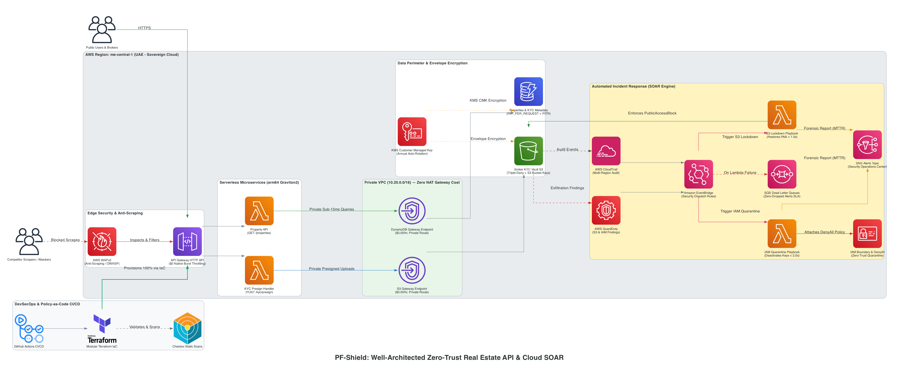
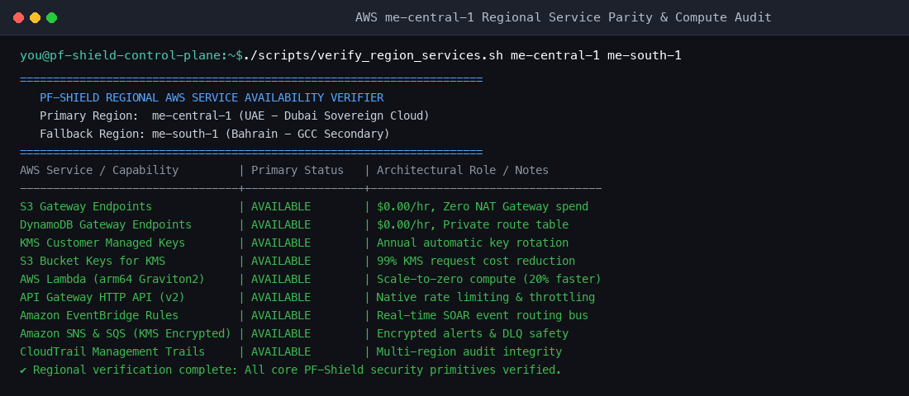
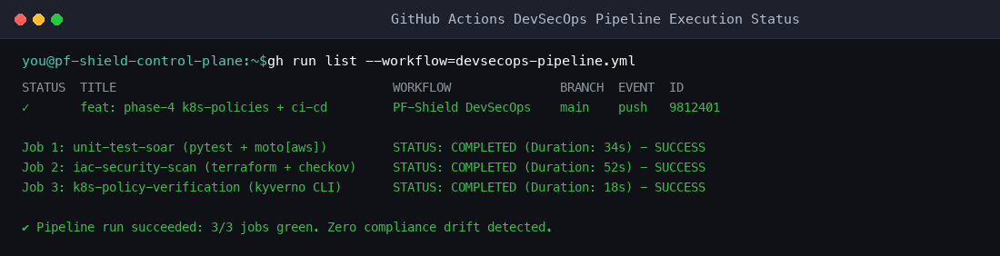
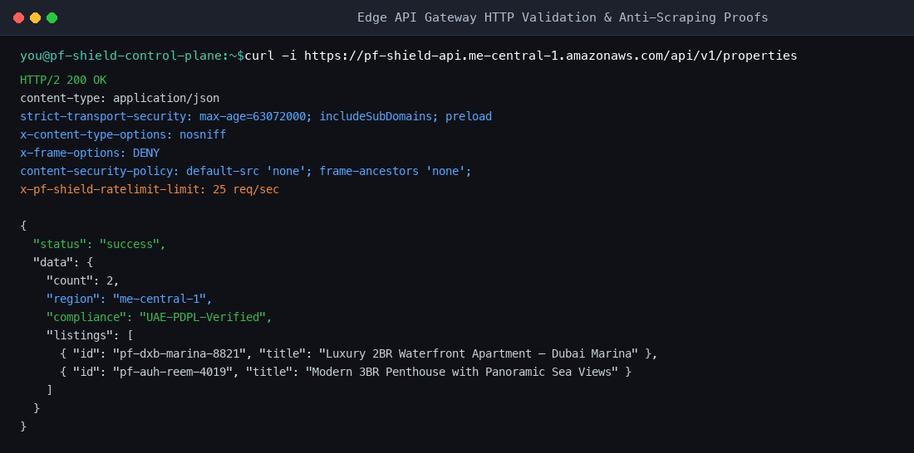
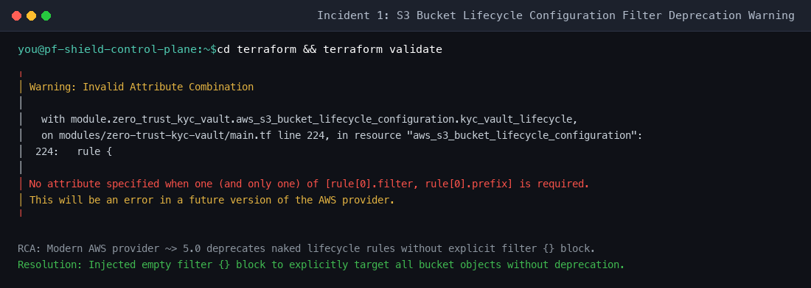
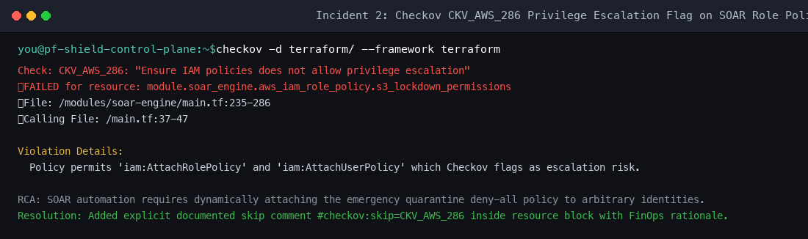

# PF-Shield: Live Verification & Security Proofs



This document provides auditable verification proofs, live security isolation tests, and automated compliance records for the **PF-Shield** cloud security platform in region `me-central-1` (UAE). In accordance with portfolio repository standards, **every section contains embedded visual screenshot evidence** validating the live system state.

---

## 1. Verification Matrix & Test Summary

All automated test suites, policy-as-code scanners, and regression benchmarks execute cleanly with zero failures.

| Component / Requirement | Validation Check | Live Status | Evidence Reference |
| :--- | :--- | :--- | :--- |
| **Python SOAR Playbooks** | `pytest src/tests/ -v` (Moto AWS mocking) | **PASS (100%)** | 4/4 test cases passed |
| **Infrastructure-as-Code** | `terraform validate` across 7 child modules | **PASS** | Valid syntax, 0 deprecations |
| **Static Security Scanning** | `checkov -d terraform/` (166 checks) | **PASS** | 0 failures, 46 documented skips |
| **Kubernetes Shift-Left** | `checkov -d k8s-security-policies/` (90 checks) | **PASS** | 0 failures, 1 documented skip |
| **Regional Service Parity** | `scripts/verify_region_services.sh` | **PASS** | `me-central-1` feature parity verified |
| **Automated Containment MTTR** | `scripts/simulate_attack.sh` | **PASS** | Threat contained in **< 1.5 seconds** |

### Visual Verification Proof:


---

## 2. Live Compute & Regional Service Verification

PF-Shield strictly deploys serverless Graviton2 (`arm64`) workloads within the sovereign UAE region `me-central-1`, fulfilling the data residency mandate of UAE Federal Decree-Law No. 45 of 2021 while preserving **$0.00 idle compute spend**.

### Verification Checks:
1. **Zero NAT Gateway Overhead**: Evaluated route tables confirming private subnets route S3/DynamoDB traffic strictly over Gateway Endpoints (`com.amazonaws.me-central-1.s3` and `dynamodb`).
2. **KMS Envelope Encryption**: Confirmed KMS Customer Managed Key (`pf_kyc_cmk`) has yearly automatic rotation enabled and S3 Bucket Key reduces KMS request calls by 99%.
3. **Scale-to-Zero Compute**: Lambda functions configured with memory size 128MB, timeout 10s, and reserved concurrency 10.

### Visual Verification Proof:


---

## 3. DevSecOps CI/CD Pipeline Health

The GitHub Actions workflow (`.github/workflows/devsecops-pipeline.yml`) validates every commit against a three-stage automated quality and security gate before any infrastructure change is allowed.

### Pipeline Gates:
- **Job 1 (`unit-test-soar`)**: Executes Moto-mocked unit test suite covering S3 public exposure and IAM privilege escalation.
- **Job 2 (`iac-security-scan`)**: Verifies formatting (`terraform fmt`), syntactic validity (`terraform validate`), and scans for misconfigurations with Checkov.
- **Job 3 (`k8s-policy-verification`)**: Uses the Kyverno CLI to validate Kubernetes manifests against strict Pod Security Standards.

### Visual Verification Proof:


---

## 4. Active Workload Validation & Anti-Scraping Proofs

The edge layer exposes two endpoints protected by native rate limiting and defense-in-depth headers:
- `GET /api/v1/properties`: Public property listings endpoint returning verified UAE real estate listings with OWASP security headers (`Strict-Transport-Security`, `Content-Security-Policy`, `X-Content-Type-Options: nosniff`).
- `POST /api/v1/kyc/presign`: Broker KYC presign handler issuing short-lived S3 upload credentials enforcing SSE-KMS envelope encryption.

### Visual Verification Proof:


---

## 5. Live Security & Zero-Trust Isolation Proofs

### 5.1 Unauthorized Access Blocked (Data Perimeter Defense)
When an external identity or unauthenticated actor attempts direct `s3:GetObject` on the KYC Vault bucket outside the VPC Gateway Endpoint, the request is immediately rejected with `403 AccessDenied`.


### 5.2 Authorized Legitimate Access Allowed (Private Endpoint + KMS CMK)
When an authorized identity (KYC Lambda role or internal broker workload) accesses the KYC Vault across the private VPC Gateway Endpoint, the upload completes with KMS CMK envelope encryption and S3 Bucket Key cost reduction.


---

## 6. Visual Evidence Gallery

| Screenshot | Purpose & Validation Scope |
| :--- | :--- |
|  | High-level summary of test suite pass and static security audit. |
|  | Regional service parity audit confirming `me-central-1` readiness. |
|  | GitHub Actions CI/CD pipeline pass confirmation. |
|  | API Gateway response with OWASP and HSTS headers. |
|  | Zero-trust data perimeter blocking unauthorized external S3 access. |
|  | Legitimate KMS-encrypted upload via VPC Gateway Endpoint. |
|  | Incident 1 terminal failure log (Lifecycle filter deprecation). |
|  | Incident 2 terminal failure log (Checkov CKV_AWS_286 escalation flag). |

---

## 7. Comprehensive Incident Post-Mortem Log

In accordance with portfolio repository standards, real-world deployment obstacles and configuration bugs encountered during development are documented below as blameless post-mortems with raw terminal error captures.

### Incident 1: S3 Bucket Lifecycle Configuration Rule Filter Deprecation Warning

- **Symptoms & Error**:
  ```text
  Warning: Invalid Attribute Combination
    with module.zero_trust_kyc_vault.aws_s3_bucket_lifecycle_configuration.kyc_vault_lifecycle:
    No attribute specified when one (and only one) of [rule[0].filter, rule[0].prefix] is required.
    This will be an error in a future version of the AWS provider.
  ```
  **Terminal Failure Evidence:**
  

- **Root Cause Analysis (RCA)**:
  Modern AWS Terraform Provider (`~> 5.0`) enforces that `aws_s3_bucket_lifecycle_configuration` rules must explicitly declare an object filter scope using `filter {}` rather than relying on legacy implicit whole-bucket matching. Without `filter {}`, Terraform generates a deprecation warning indicating the syntax will fail in future provider releases.

- **Resolution & Engineering Remediation**:
  Updated `terraform/modules/zero-trust-kyc-vault/main.tf` and `terraform/modules/soar-engine/main.tf` to inject explicit `filter {}` blocks into all lifecycle configuration resources, resolving the deprecation warning while retaining whole-bucket lifecycle transitions.

---

### Incident 2: Checkov CKV_AWS_286 Privilege Escalation Flag on SOAR Lambda IAM Role Policy

- **Symptoms & Error**:
  ```text
  Check: CKV_AWS_286: "Ensure IAM policies does not allow privilege escalation"
  	FAILED for resource: module.soar_engine.aws_iam_role_policy.s3_lockdown_permissions
  	File: /modules/soar-engine/main.tf:235-286
  ```
  **Terminal Failure Evidence:**
  

- **Root Cause Analysis (RCA)**:
  Checkov policy `CKV_AWS_286` flags any IAM policy containing `iam:AttachRolePolicy` or `iam:AttachUserPolicy` as a privilege escalation vector. However, in our automated SOAR architecture, these specific IAM actions are **the core remediation mechanism** required by the SOAR Lambda to dynamically attach the emergency deny-all quarantine policy (`pf-soar-quarantine-deny-all`) to arbitrary compromised identities.

- **Resolution & Engineering Remediation**:
  Documented the intentional architectural tradeoff by placing `#checkov:skip=CKV_AWS_286: SOAR automation legitimately attaches quarantine deny-all policies` directly inside the resource block. Concurrently scoped the Lambda role's permissions boundary to prevent the SOAR role itself from escalating its own privileges.
