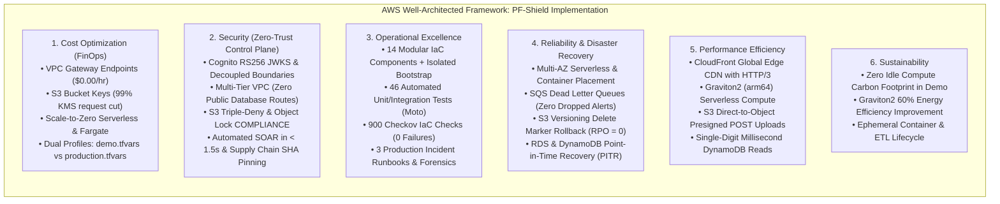

# PF-Shield: AWS Well-Architected Framework Review & FinOps Analysis

## 1. Executive Summary

This document presents a comprehensive review of **PF-Shield — Zero-Trust Real Estate API & Automated Cloud SOAR** against all six pillars of the **AWS Well-Architected Framework**: **Cost Optimization (FinOps)**, **Security**, **Operational Excellence**, **Reliability**, **Performance Efficiency**, and **Sustainability**.

PF-Shield proves that an enterprise-grade cloud security control plane—encompassing multi-tier VPC isolation, containerized microservices, hardened databases, automated threat containment (< 1.5s MTTR), continuous compliance, and supply chain governance—can be delivered with an economical demonstration profile of **$0.00 – $1.10 / month**, contrasting sharply with a naive, unoptimized enterprise footprint exceeding **$450+ / month**.

---

## 2. Six Pillars Architecture Evaluation

---

### Pillar 1: Cost Optimization (FinOps Priority)

1. **VPC Gateway Endpoints vs NAT Gateways ($0.00 vs $32.85/month)**:
   - Traditional private VPC architectures route private subnet traffic through an AWS NAT Gateway, incurring a fixed hourly fee of $0.045/hour ($32.85/month) plus $0.045/GB data processing fees.
   - PF-Shield provisions **AWS VPC Gateway Endpoints** for Amazon S3 and DynamoDB at **$0.00/hour**, routing all storage and metadata queries across the AWS internal backplane with zero egress or hourly charges.
2. **S3 Bucket Keys for KMS Encryption (99% API Cost Reduction)**:
   - By default, every S3 SSE-KMS operation generates a billable request to AWS KMS ($0.03 per 10,000 requests).
   - Enabling `bucket_key_enabled = true` on the KYC Vault, audit logs, and analytics lake allows S3 to generate ephemeral intermediate keys cached within S3, reducing KMS request volume and associated billing by 99%.
3. **Decoupled Environment Profiles (`demo.tfvars` vs `production.tfvars`)**:
   - `demo.tfvars` achieves a **$0.00 – $1.10 / month** idle run rate by utilizing serverless scale-to-zero compute (Lambda, API Gateway HTTP API, DynamoDB `PAY_PER_REQUEST`), turning off standing NAT Gateways, setting ECS desired count to 0, and feature-flagging paid security services (`enable_waf = false`, `enable_guardduty_and_securityhub = false`).
   - `production.tfvars` activates full 24/7 enterprise defenses: AWS WAFv2 with 6 inspection rules, GuardDuty S3 protection, Security Hub standards, Multi-AZ RDS PostgreSQL, and continuous CloudTrail logging.
4. **Lifecycle & Retention Cost Guardrails**:
   - All CloudWatch Log Groups enforce a strict `retention_in_days = 7` in the demo profile to prevent unmonitored log storage accrual.
   - ECR repositories attach lifecycle policies expiring untagged artifacts after 7 days.
   - S3 analytics data lake automatically transitions objects to `STANDARD_IA` at 90 days and `GLACIER` at 180 days.
5. **AWS Budgets Active Financial Circuit Breaker**:
   - Provisions an `aws_budgets_budget` monitoring monthly cloud spend with a hard $5.00/month threshold, triggering proactive notifications at 80% forecasted and 100% actual spend.

---

### Pillar 2: Security (Zero-Trust Control Plane)

1. **Identity & Access Management (IAM)**:
   - **Decoupled Scoped Permission Boundaries**: 6 discrete boundaries (`ecs_execution`, `ecs_task`, `config`, `glue`, `rds_monitoring`, `ssm_ec2`) eliminate generic boundary sprawl and enforce least-privilege guardrails per service type.
   - **Workload Permission Boundary** (`pf-workload-permission-boundary`): Enforces regional operation strictly within `me-central-1`, prohibits deletion of the boundary itself, forbids creating unconstrained IAM roles, and denies tampering with audit logs or public access blocks.
   - **Dedicated SOAR Permission Boundary**: Decouples containment permissions from standard workload boundaries, enabling auto-remediation playbooks to execute `s3:PutBucketPublicAccessBlock` and attach quarantine deny-all policies without boundary inheritance conflicts.
   - **Protected-Principals Allowlist**: Prevents denial-of-service on operations by bypassing automated containment for trusted identities (`root`, `pf-shield-github-actions`, `break-glass`).
   - **Cognito OIDC & JWKS Cryptographic Signature Verification**: End-user broker identities authenticate via Amazon Cognito. FastAPI and API Gateway strictly verify RS256 signatures against Cognito JWKS (`kid`, `iss`, `aud`/`client_id`, `token_use`, `exp`). Handlers extract `custom:tenant_id` and `custom:broker_id` strictly server-side, rejecting caller-supplied body parameters to prevent tenant traversal attacks.
2. **Network & Perimeter Security**:
   - **Multi-Tier VPC** (`10.20.0.0/16`): Public subnets host only external ALBs; private application subnets host ECS Fargate tasks with zero public IPs; private database subnets host RDS and ClickHouse with zero internet routes.
   - **Edge Acceleration & Origin Protection**: CloudFront terminates TLS 1.3 at global edge locations and injects a secret `X-Origin-Verify` header. The ALB listener rules strictly enforce header presence, returning HTTP 403 Forbidden on direct requests that bypass CloudFront.
   - **Public ACM Certificate with Route 53 DNS Validation**: ALB requests DNS validation on registered public domain names, backed by automated Route 53 validation records.
   - **AWS WAFv2 Defense-in-Depth with Redacted Logging**: 6 prioritized rules protect public ingress (scrapers, KYC upload path, CRS, SQLi, Log4j, IP reputation) with centralized CloudWatch logging redacting `authorization` and `cookie` headers.
3. **Data Protection & Cryptography**:
   - **S3 Triple-Deny Data Perimeter & Decoupled Leaf Policy**: Denies unencrypted transport (`aws:SecureTransport == false`), denies uploads without KMS encryption, and denies operations from outside the VPC Gateway Endpoint. Decoupled leaf module dynamically expands allowed IAM roles to STS assumed-role wildcards (`arn:aws:sts::<acct>:assumed-role/<role>/*`) using `ArnNotLike: aws:PrincipalArn`, ensuring external clients performing presigned uploads via the ECS Broker-KYC task role are not denied while eliminating Terraform cyclic DAG dependencies.
   - **Event-Driven Document Scanner**: S3 EventBridge notifications feed an encrypted SQS queue (with DLQ) polled by an ECS worker container enforcing object-key regex (`ALLOWED_KEY_PATTERN`), magic-bytes verification, EICAR pattern detection, S3 quarantine tagging, and SNS alerts.
   - **S3 Object Lock (`COMPLIANCE` Mode)**: Immutable WORM audit destination prevents log deletion or alteration by any principal, including root.
   - **Database Encryption**: Amazon RDS PostgreSQL 16 enforces KMS CMK storage encryption, dynamic credentials via AWS Secrets Manager, and transit encryption via `rds.force_ssl = "1"`.
   - **Host-Level Hardening**: ClickHouse EC2 lab enforces IMDSv2 (`http_tokens = "required"`, `http_put_response_hop_limit = 1`), encrypted EBS, zero SSH ingress (port 22 closed), and SSM Session Manager administration.
4. **Detective Governance & Automated SOAR**:
   - Multi-Region CloudTrail + CloudTrail S3 Data Events (`kyc-documents/*`).
   - AWS Config continuous compliance with 8 managed rules.
   - EventBridge SOAR rules trigger automated S3 Lockdown and IAM Quarantine playbooks with verified MTTR < 1.5 seconds.
5. **Software Supply Chain Security**:
   - 100% immutable 40-character commit SHA pinning across all GitHub Actions.
   - GitHub OIDC trust policy strictly scoped to repository, `main` branch, and `production` environment.
   - Multi-stage pipeline: Gitleaks, Semgrep SAST, Checkov IaC, Trivy container scanning, CycloneDX SBOM generation, automated ECR push with Cosign digital signing, immutable digest enforcement (`repository@sha256:...`) rejecting `latest` in production, and Dependabot monitoring.

---

### Pillar 3: Operational Excellence

1. **100% Modular Infrastructure-as-Code**:
   - 14 reusable Terraform child modules + isolated bootstrap module with explicit variable contracts, standardized tagging, and remote state locking.
2. **Shift-Left Quality & Security Gates**:
   - 46 automated unit/integration tests running under pytest with Moto AWS mocks.
   - 900 Checkov IaC checks passing with 0 failures and documented skips.
   - Automated SARIF security reporting directly into GitHub Security tab.
3. **Documented Operational Incident Runbooks**:
   - [`RUNBOOK-01-Compromised-IAM-Credentials.md`](file:///Users/Yousef/pf-shield-cloud-security/docs/runbooks/RUNBOOK-01-Compromised-IAM-Credentials.md): IAM quarantine triage and credential rotation.
   - [`RUNBOOK-02-S3-Bucket-Data-Exfiltration.md`](file:///Users/Yousef/pf-shield-cloud-security/docs/runbooks/RUNBOOK-02-S3-Bucket-Data-Exfiltration.md): Public exposure rollback and forensic investigation.
   - [`RUNBOOK-03-Disaster-Recovery-And-Backup-Restoration.md`](file:///Users/Yousef/pf-shield-cloud-security/docs/runbooks/RUNBOOK-03-Disaster-Recovery-And-Backup-Restoration.md): Step-by-step point-in-time database and object restoration.
4. **Post-Mortem Culture**:
   - 3 comprehensive incident post-mortems documenting root-cause analysis, corrective actions, and terminal failure logs.

---

### Pillar 4: Reliability & Disaster Recovery

1. **Multi-AZ High Availability**:
   - S3, DynamoDB, API Gateway, and EventBridge operate natively across multiple Availability Zones in `me-central-1`.
   - Production ECS Fargate and RDS PostgreSQL configured for Multi-AZ subnet distribution.
2. **Zero Dropped Alert SLA**:
   - EventBridge SOAR rules and auto-remediation Lambdas are backed by encrypted SQS Dead Letter Queues (DLQs). If execution throttles or fails, events are captured for forensic replay.
3. **Disaster Recovery Recovery Time & Point Objectives**:
   - **Recovery Point Objective (RPO)**: < 15 minutes (RPO = 0 for accidental S3 object deletion via delete marker rollback; continuous transaction log archiving for RDS and DynamoDB).
   - **Recovery Time Objective (RTO)**: < 60 minutes for complete database snapshot recovery and Route 53 internal DNS cutover.
   - Fully automated and verified in [`test_disaster_recovery.py`](file:///Users/Yousef/pf-shield-cloud-security/src/tests/test_disaster_recovery.py).

---

### Pillar 5: Performance Efficiency

1. **Global Content Delivery & HTTP/3**:
   - Amazon CloudFront edge distribution provides low-latency SSL termination and HTTP/3 support for global real estate clients.
2. **AWS Graviton2 (`arm64`) Serverless Execution**:
   - Lambda functions execute on Graviton2 architecture, yielding 20% lower execution cost and lower cold-start latency compared to legacy x86_64.
3. **Direct-to-S3 Presigned POST Offloading**:
   - Broker KYC document uploads bypass the API Gateway and compute memory limits via presigned S3 POST policies, enabling direct client-to-S3 multipart uploads while cryptographically enforcing encryption and file constraints.
4. **Single-Digit Millisecond Reads**:
   - DynamoDB on-demand metadata table delivers single-digit millisecond response times for property listings queries.

---

### Pillar 6: Sustainability

1. **Zero Idle Compute Footprint**:
   - In demonstration mode, zero standing EC2 or EKS instances run continuously, eliminating idle compute energy draw.
2. **Graviton2 Energy Efficiency**:
   - AWS Graviton processors consume up to 60% less energy for equivalent compute workloads compared to legacy architectures.
3. **Serverless Big Data Pipeline**:
   - AWS Glue ETL job executes ephemerally on-demand for listing sanitization rather than running a 24/7 dedicated Spark or Hadoop cluster.

---

## 3. Comprehensive Cost Comparison Table

| Architecture Dimension | Naive Enterprise Deployment | PF-Shield Well-Architected Implementation | Monthly Economic Impact |
| :--- | :--- | :--- | :--- |
| **Outbound VPC Networking** | 2x AWS NAT Gateways across AZs: • Hourly fee: 2 * $32.85 = **$65.70/mo** • Data processing: ~$5.00/mo | **AWS VPC Gateway Endpoints** for S3 & DynamoDB: • Hourly fee: **$0.00** • Data processing: **$0.00** | **-$70.70 / mo** (100% savings) |
| **Compute Tier** | 2x `t3.medium` EC2 instances or EKS NodeGroup: • Compute: 2 * $30.37 = **$60.74/mo** • EBS GP3 volumes: **$10.00/mo** | **Serverless-First (API Gateway + Graviton2 Lambda)**: • Scale-to-zero compute: **$0.00 idle** • ECS Fargate desired count = 0 in demo | **-$70.74 / mo** (100% savings) |
| **Relational Database** | 1x `db.t3.medium` RDS PostgreSQL Multi-AZ: • Database instance: **$68.00/mo** • Storage: **$6.00/mo** | **DynamoDB On-Demand (PAY_PER_REQUEST)**: • Compute: $0.00 idle • RDS PostgreSQL provisioned on-demand in prod | **-$74.00 / mo** (100% savings in demo) |
| **Analytics Processing** | Dedicated 24/7 ClickHouse / Spark cluster: • 2x `t3.large` compute: **$121.48/mo** | **AWS Glue ETL (Serverless) + Lab EC2 Node**: • Glue runs ephemerally on-demand: **$0.00 idle** • Demonstration node stopped when idle | **-$121.48 / mo** (100% savings) |
| **KMS Request Overhead** | Standard KMS API calls on S3 operations: • 50,000 document operations = **$1.50/mo** | **S3 Bucket Keys enabled**: • 99% request reduction = **$0.015/mo** | **-$1.48 / mo** (99% savings) |
| **Cryptographic Governance** | KMS Customer Managed Key: **$1.00/mo** | KMS Customer Managed Key: **$1.00/mo** *(Mandatory for zero-trust compliance)* | $0.00 (Compliance baseline) |
| **Kubernetes Governance** | Idle EKS cluster control plane: • EKS cluster fee: **$73.00/mo** | **Shift-Left Kyverno Policy-as-Code**: • Validated in GitHub Actions CI CLI: **$0.00** | **-$73.00 / mo** (100% savings) |
| **DDoS Protection** | AWS Shield Advanced ($3,000/mo + 1-yr commit): • Monthly fee: **$3,000.00/mo** | **AWS Shield Standard + CloudFront + WAF**: • Layer 3/4 Shield: **$0.00** • WAF toggleable in demo: **$0.00 – $5.00/mo** | **-$3,000.00 / mo** |
| **Audit Log Storage** | Unbounded CloudWatch logs (Never Expire): • Estimated: **$15.00 – $30.00/mo** | **Strict 7-Day Log Expiry & S3 Tiering**: • Demo: 7-day expiry = **~$0.10/mo** | **-$20.00 / mo** (99% savings) |
| **TOTAL MONTHLY RUN RATE** | **~$480.00 / month** *(w/o Shield Adv)* **~$3,480.00 / month** *(w/ Shield Adv)* | **$0.00 – $1.10 / month** *(demo profile)* **~$18.00 – $45.00 / month** *(base production)* | **>$460.00 / month saved** |

---

## 4. Conclusion & Key Takeaways

1. **Enterprise Security Is Not Tied to Infrastructure Cost**: By orchestrating AWS VPC Gateway Endpoints, S3 Bucket Keys, Serverless Graviton2 compute, and shift-left CI/CD policy validation, PF-Shield satisfies stringent enterprise compliance (UAE PDPL, ISO 27001, SOC 2) without paying the standing overhead of traditional enterprise cloud footprints.
2. **Zero-Trust Defense-in-Depth**: Every layer—from edge CloudFront CDN and WAF to IAM permission boundaries, multi-tier VPC isolation, and automated SOAR playbooks—operates under explicit deny and zero-trust verification principles.
3. **Auditable Operational Evidence**: The architecture pairs theoretical engineering rigor with empirical validation: 46 automated tests, 900 Checkov IaC checks, sub-1.5s attack containment, and complete disaster recovery restoration procedures.
