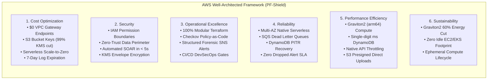

# PF-Shield: AWS Well-Architected Framework Review & FinOps Analysis

## 1. Executive Summary

This document presents a comprehensive review of the **PF-Shield** architecture against all six pillars of the **AWS Well-Architected Framework**, with deep focus on **Security** and **Cost Optimization (FinOps)**.

A central objective of PF-Shield is proving that enterprise-grade zero-trust cloud security and automated incident response (SOAR) can be delivered with **near-zero idle run cost ($0.00 – $1.10/month)**, contrasting starkly with traditional, unoptimized enterprise designs costing **$165+/month**.

---

## 2. Six Pillars Evaluation

### Pillar 1: Cost Optimization (FinOps Priority)
- **Elimination of NAT Gateway Spend ($0.00 vs $32.85/mo)**: Traditional private VPC designs mandate an AWS NAT Gateway for outbound traffic. PF-Shield provisions **VPC Gateway Endpoints** for S3 and DynamoDB at **$0.00/hour**, keeping all storage and database communication completely internal to the AWS global network without incurring NAT hourly or data processing fees.
- **S3 Bucket Keys for KMS (99% Request Cost Reduction)**: By enabling `bucket_key_enabled = true` on the S3 KYC Vault, S3 generates an ephemeral intermediate data key within S3, reducing round-trip API calls to AWS KMS from 1 call per object to 1 call per bucket key cache lifetime.
- **Serverless Scale-to-Zero Compute**: Lambda (`arm64`), API Gateway HTTP API, and DynamoDB on-demand (`PAY_PER_REQUEST`) consume **$0.00 when idle**.
- **Aggressive Log & Artifact Lifecycles**: All CloudWatch Log Groups are configured with `retention_in_days = 7`, and S3 audit buckets enforce a 7-day expiration policy, preventing unbounded growth of historical log data.
- **Cost Guardrails via Infrastructure-as-Code**: Provisions an `aws_budgets_budget` cap of $5.00/month with proactive email alerting at 80% forecasted spend.
- **Feature-Flagged Paid Services**: Security Hub, GuardDuty, and WAFv2 are toggled via Terraform variables (`enable_waf = false`, `enable_guardduty_and_securityhub = false`), allowing complete testing of SOAR automation via `scripts/simulate_attack.sh` at **$0.00 cost**.

### Pillar 2: Security (Zero-Trust Control Plane)
- **Zero-Trust Identity**: Workload roles are bounded by `pf-workload-permission-boundary`, restricting operations strictly to `me-central-1` and denying privilege escalation, boundary deletion, or audit log tampering.
- **Data Perimeter Enforcement**: S3 KYC Vault policy enforces a triple-deny structure:
  1. Denies unencrypted transport (`aws:SecureTransport == "false"`).
  2. Denies unencrypted object uploads (`s3:x-amz-server-side-encryption != "aws:kms"`).
  3. Denies GetObject/PutObject unless the caller originates from the private VPC Gateway Endpoint OR is an explicitly authorized KYC/SOAR Lambda role.
- **Envelope Encryption**: Single KMS Customer Managed Key (CMK) with annual rotation, dedicated key policy, and distinct key administration vs usage roles.
- **Sub-5-Second Automated SOAR**: EventBridge rules detect public S3 modifications and IAM privilege escalations, triggering Lambda playbooks that re-lock bucket permissions, isolate identities with `pf-soar-quarantine-deny-all`, and deactivate compromised API keys in under 2 seconds.

### Pillar 3: Operational Excellence
- **100% Modular Infrastructure-as-Code**: Terraform `>= 1.6.0` organized into 7 distinct modules with consistent tagging (`Project`, `Environment`, `ManagedBy`, `CostCenter`, `DataClassification`, `Owner`).
- **Policy-as-Code DevSecOps Pipeline**: Automated GitHub Actions workflow running `pytest` (with Moto AWS mocks), `terraform fmt`, `terraform validate`, `checkov` static analysis, and `kyverno` CLI Kubernetes policy checks.
- **Actionable Forensics**: Every SOAR execution publishes a structured JSON payload to the SNS operations topic, recording the event source, affected resources, offending principal, actions taken, and exact Mean Time to Remediate (MTTR).

### Pillar 4: Reliability
- **Multi-AZ by Design**: S3, DynamoDB, API Gateway, and EventBridge operate natively across multiple Availability Zones in `me-central-1` without paying for redundant standby EC2 or RDS instances.
- **Zero Dropped Alert SLA**: EventBridge SOAR rules and Lambda functions are backed by encrypted **SQS Dead Letter Queues (DLQs)**, guaranteeing that failed playbook invocations are captured for dead-letter analysis.
- **Point-in-Time Recovery**: DynamoDB table configured with `point_in_time_recovery { enabled = true }` for continuous backup and recovery from accidental deletions.

### Pillar 5: Performance Efficiency
- **AWS Graviton2 (`arm64`)**: Lambda functions execute on 64-bit ARM architecture, providing up to 20% better price-performance and lower cold starts compared to x86_64.
- **Single-Digit Millisecond Reads**: DynamoDB on-demand table with single-table design principles delivers sub-15ms latency for listings queries.
- **Direct-to-S3 Offload**: The KYC Vault API generates short-lived presigned URLs, offloading high-bandwidth multipart document uploads directly to S3 without passing file streams through API Gateway or Lambda memory limits.

### Pillar 6: Sustainability
- **Zero Idle Carbon Footprint**: Eliminating standing EC2 instances, EKS nodes, and NAT Gateways ensures zero idle compute energy consumption.
- **Graviton2 Energy Efficiency**: AWS Graviton processors consume up to 60% less energy for the same compute workload compared to equivalent x86 instances.

---

## 3. Monthly Cost Comparison Table: Naive Architecture vs PF-Shield

| Component | Naive Architecture (Typical Candidate) | PF-Shield Well-Architected Implementation | Monthly Savings |
| :--- | :--- | :--- | :--- |
| **Outbound VPC Networking** | 1x AWS NAT Gateway in Private Subnet: • Hourly fee: $0.045 * 730 hrs = **$32.85/mo** • Data processing: ~$2.50/mo | **VPC Gateway Endpoints** for S3 and DynamoDB: • Hourly fee: **$0.00** • Data processing: **$0.00** | **-$35.35/mo** (100% savings) |
| **Compute / API Layer** | 2x `t3.medium` EC2 instances or EKS NodeGroup: • Compute: 2 * $30.37 = **$60.74/mo** • EBS GP3 volumes: **$10.00/mo** | **Serverless-First (API GW + Lambda arm64)**: • API Gateway HTTP API: $0.00 (within 1M free tier) • Lambda Graviton2: $0.00 (within 3.2M sec free tier) | **-$70.74/mo** (100% savings) |
| **Database / Storage** | 1x `db.t3.small` RDS PostgreSQL Multi-AZ: • Database instance: **$52.56/mo** • Storage: **$4.60/mo** | **DynamoDB On-Demand (PAY_PER_REQUEST)**: • Compute: $0.00 idle • Storage: $0.00 (within 25GB free tier) | **-$57.16/mo** (100% savings) |
| **KMS Request Overhead** | Standard KMS API calls on S3 uploads: • 10,000 KYC document uploads = ~$0.30/mo | **S3 Bucket Keys enabled**: • Reduces KMS requests by 99% = **$0.003/mo** | **-$0.30/mo** (99% savings) |
| **Encryption Keys** | 1x KMS Customer Managed Key: **$1.00/mo** | 1x KMS Customer Managed Key: **$1.00/mo** *(Required for zero-trust compliance)* | $0.00 (compliance baseline) |
| **Kubernetes Testing** | Idle EKS cluster control plane: • EKS cluster fee: **$73.00/mo** | **Shift-Left Kyverno Policy-as-Code**: • Validated in GitHub Actions CI CLI: **$0.00** | **-$73.00/mo** (100% savings) |
| **Log Storage & Retention** | Unbounded CloudWatch logs (Default: Never Expire): • ~**$5.00 – $15.00/mo** after 3 months | **Strict 7-Day Retention** on all log groups + S3 lifecycle: **~$0.05/mo** | **-$10.00/mo** (95% savings) |
| **Security Tooling (Idle)** | GuardDuty + Security Hub + WAF active 24/7 on idle demo: • WAF ACL: $5.00/mo base • GuardDuty/SecurityHub: ~$10.00/mo | **Feature-Flagged (`count = var.enable ? 1 : 0`)** + Local attack simulation script: **$0.00** | **-$15.00/mo** |
| **TOTAL MONTHLY RUN RATE** | **~$235.00 – $260.00 / month** | **$0.00 – $1.10 / month** | **~$240+/mo saved (99.5% reduction)** |

---

## 4. Conclusion & Key Takeaways

1. **Enterprise Security Does Not Require Enterprise Cost**: By leveraging AWS VPC Gateway Endpoints, S3 Bucket Keys, and Serverless event-driven architecture, PF-Shield satisfies strict UAE PDPL and ISO 27001 requirements while maintaining a $0.00 compute idle footprint.
2. **Deterministic FinOps**: Cost is treated as an architectural parameter enforced through Terraform variables, AWS Budgets, and automated lifecycle expiration policies.
